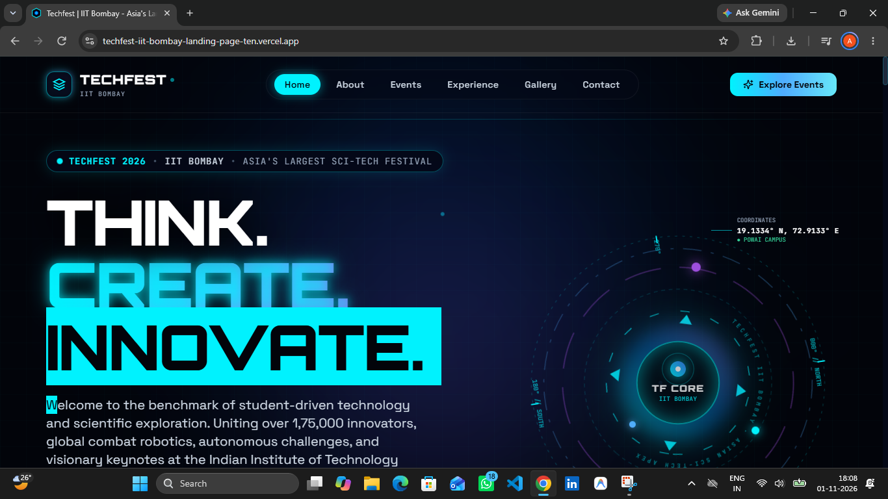
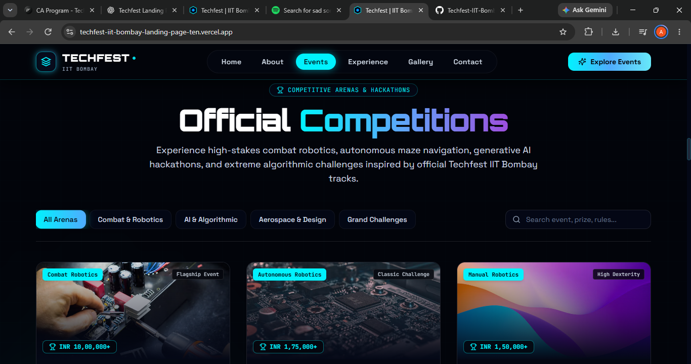

# Techfest IIT Bombay – Landing Page

[](https://react.dev/)
[](https://vitejs.dev/)
[](https://tailwindcss.com/)
[](LICENSE)

---

## Overview
A modern, responsive landing page inspired by the official **Techfest IIT Bombay** website. The project showcases a futuristic design for a science and technology festival using **React**, **Vite**, and **Tailwind CSS**.

---

## Features
- **Hero Section** with animated orbital rings and CTA buttons.
- **Navigation Bar** with smooth scrolling and mobile drawer.
- **About Section** with editorial layout.
- **Events Section** displaying event cards with hover animations.
- **Experience Section** highlighting festival experiences.
- **Gallery** with a responsive image grid.
- **Footer** with social links and official Techfest link.
- Fully responsive across desktop, tablet, and mobile.

---

## Technologies
| Technology | Purpose |
|------------|---------|
| React 18   | Component‑based UI development |
| Vite 6.x   | Fast development server and bundler |
| Tailwind CSS 3.4 | Utility‑first styling and theming |
| Lucide React | Lightweight icons |

---

## Project Structure
```
├─ public/                # Static assets (favicon, robots.txt)
├─ src/                   # Application source code
│   ├─ components/        # Reusable UI components
│   ├─ pages/             # Page‑level components
│   ├─ assets/            # Images, SVGs, etc.
│   └─ App.jsx            # Root component
├─ tailwind.config.js     # Tailwind configuration
├─ vite.config.ts         # Vite configuration
├─ package.json           # Scripts and dependencies
└─ README.md              # Project documentation (this file)
```

---

## Screenshots
<!-- Add actual screenshots to the `screenshots/` directory and reference them below -->





---

## Installation
Prerequisites: **Node.js** (v18 or later) and **npm**.
```bash
# Clone the repository
git clone https://github.com/arnav-mittal70/Techfest-IIT-Bombay-Landing-Page.git
cd Techfest-IIT-Bombay-Landing-Page

# Install dependencies
npm install
```

---

## Development
```bash
npm run dev
```
Open the displayed local URL (usually `http://localhost:5173`) in your browser.

---

## Build
```bash
npm run build
```
The production files are generated in the `dist/` directory.

---

## Repository
- **GitHub**: https://github.com/arnav-mittal70/Techfest-IIT-Bombay-Landing-Page
- **Issues**: Use the GitHub Issues page for bug reports and feature requests.

---

## License
This project is licensed under the MIT License – see the `LICENSE` file for details.
